<p align="center">
  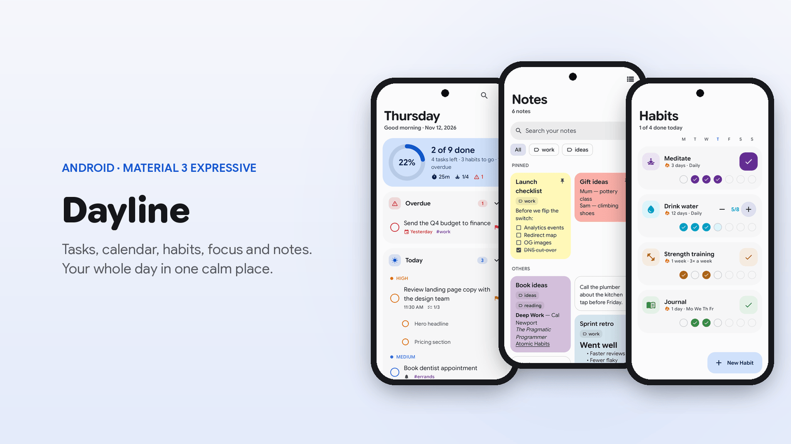
</p>

<h1 align="center">Dayline</h1>

<p align="center">
  <b>Your whole day, in one calm place.</b><br>
  Tasks, calendar, habits, focus sessions and notes in one native Android app, built with Material 3 Expressive.
</p>

<p align="center">
  
  
  
  
  
</p>

---

## Demo

<p align="center">
  
</p>

<p align="center"><a href="docs/demo.mp4">▶ Watch the full-quality video (MP4, 28 s)</a></p>

## Why Dayline

Most people juggle a to-do app, a calendar, a habit tracker, a timer and a notes app. Dayline puts all five on one screen-friendly home, so planning the day, doing the work and building routines happen in the same place.

- **Students:** track assignments with due dates, plan the exam week on the calendar, and study in focus sessions.
- **Professionals:** capture tasks in a tap, set priorities and dependencies, and keep meeting notes with checklists next to them.
- **Habit builders:** check in daily, count reps or glasses of water, and watch streaks grow on the home screen.
- **Anyone who wants calm:** one clear Today view instead of five apps, and no account, ads or tracking.

## Features

### ☀️ Today
- A daily dashboard with a progress ring for tasks **and** habits, focus time and overdue count.
- Overdue, Today and Completed sections, grouped by priority, with subtasks shown inline.
- Swipe right to complete and swipe left to delete, with undo.

### ✅ Tasks
- **Quick capture:** tap **+** to add a task, or press and hold for a note, habit or focus session.
- Natural typing: `tomorrow`, `!high` and `#tag` are understood as you write.
- Due and start dates, times, repeats (daily, weekly, monthly, custom), multiple reminders and attachments.
- **Dependencies:** a task waiting on another can't be completed or deleted until its blocker is done.
- Inbox, Upcoming (Tomorrow / This week / Next week), All tasks and Completed views.

### 📅 Calendar
- **Month, week and year** views with coloured task dots.
- Long-press a task in week view and drag it to another day to reschedule it.

### 🔥 Habits
- Daily, x-times-a-week or specific-day habits, plus counters (for example 5/8 glasses).
- Streaks, a week-at-a-glance row of check-ins, and a satisfying haptic on every check-in.

### ⏱️ Focus
- A Pomodoro-style focus timer with an expressive ring that changes shape as time passes.
- Gentle vibration in the last seconds, and it keeps running safely in the background.

### 📊 Statistics
- Day, week and month views: completed vs. remaining, completion rate, missed deadlines, focus time and habit consistency, with trends against the previous period.

### 📝 Notes
- Rich text: bold, italic, underline, strikethrough, text colour, highlight, alignment and lists.
- Inline checklists, `#labels` with custom icons, colour-coded notes, pinning and search.
- Add images, drawings and voice notes. Press and hold **New Note** to start with one.

### 🧩 Home-screen widgets
Seven widgets: **Today's tasks, Daily progress, Next up, Habit streaks, Streak flower, Focus timer** and **Quick add**. Each can have its own artistic background in Settings.

### 🎨 Design
- Material 3 Expressive throughout: Google Sans Flex, large rounded surfaces, springy motion and haptics.
- Themes: dynamic colour (Material You), monochrome, five gradients and a dynamic gradient, in light or dark.
- Tested on screens from 320 dp small phones and 130% font size to foldables and landscape.

### 🔒 Sync and privacy
- Works fully offline. Everything is stored on your phone.
- Optional **Google sync** keeps a private copy in your own Google Drive's hidden app folder and keeps your devices in step. Nothing ever goes to a Dayline server, because there isn't one.
- Export and import a full JSON backup at any time.
- [Privacy policy](https://vishalchavan7.github.io/privacy.html)

## Screenshots

<table>
  <tr>
    <td align="center">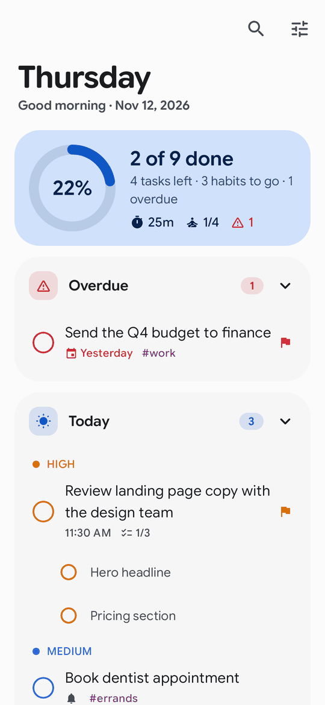<br><sub>Today</sub></td>
    <td align="center">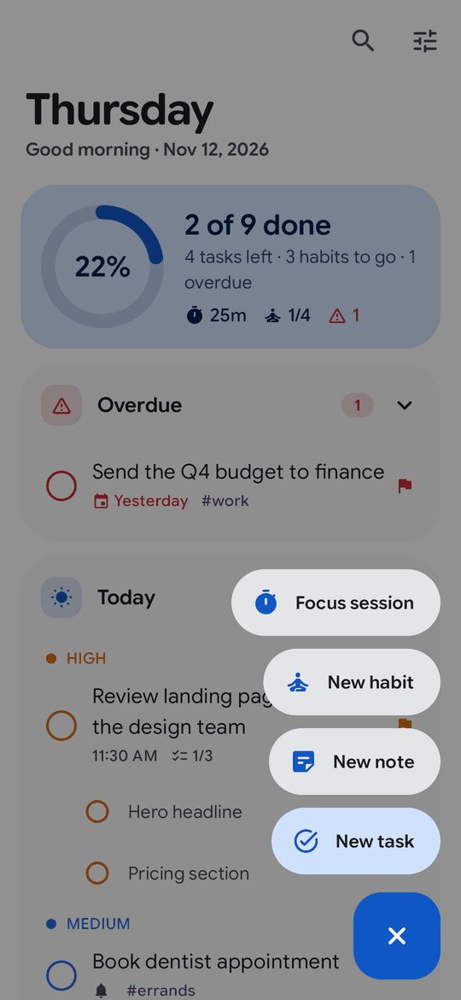<br><sub>Quick capture</sub></td>
    <td align="center">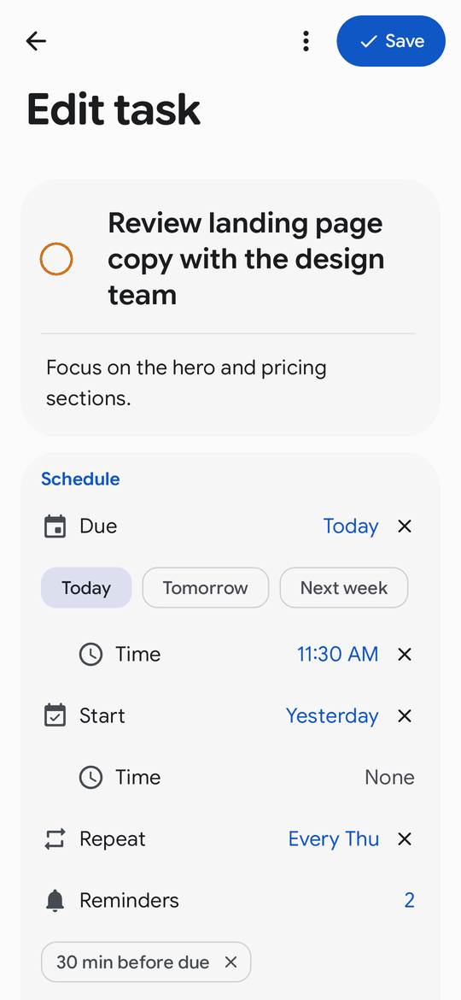<br><sub>Task details</sub></td>
    <td align="center">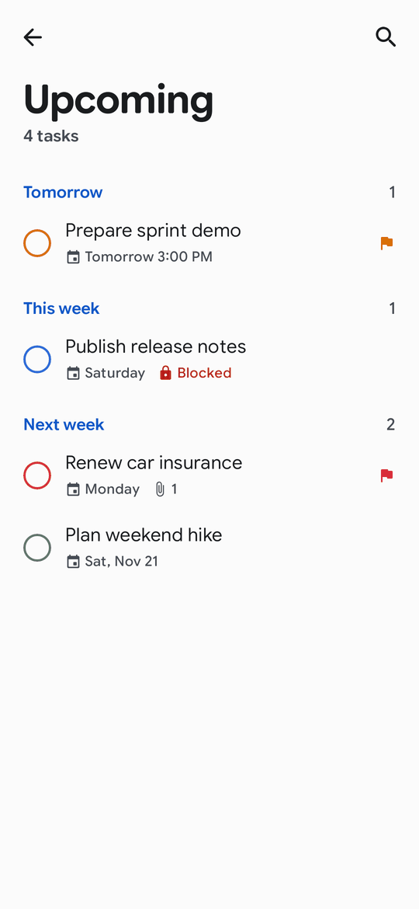<br><sub>Upcoming</sub></td>
  </tr>
  <tr>
    <td align="center">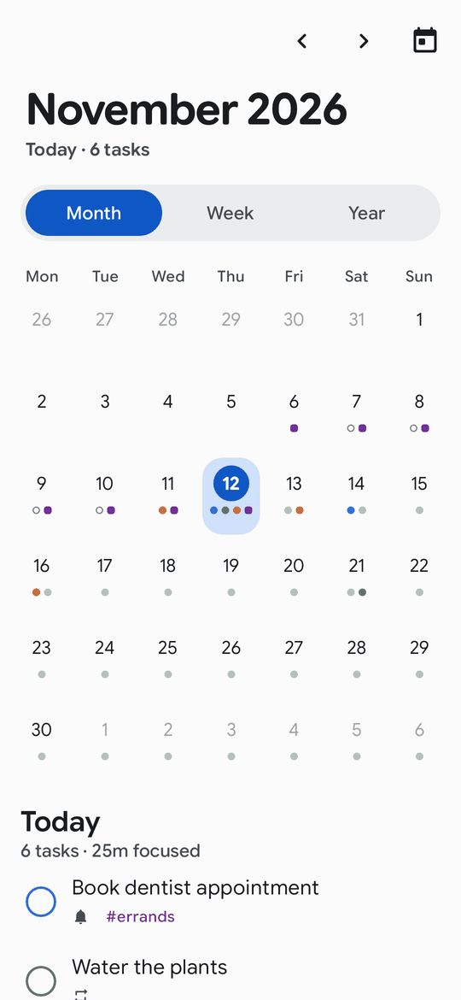<br><sub>Calendar · month</sub></td>
    <td align="center">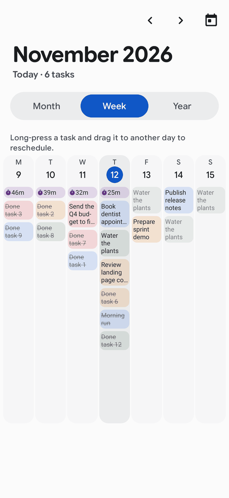<br><sub>Calendar · week</sub></td>
    <td align="center">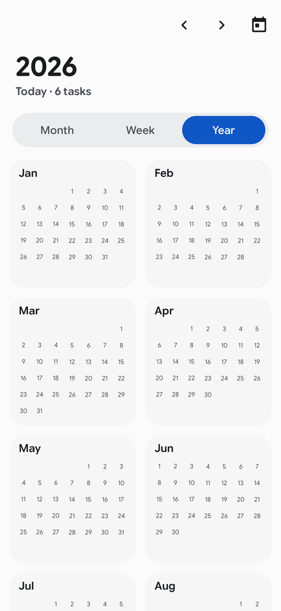<br><sub>Calendar · year</sub></td>
    <td align="center">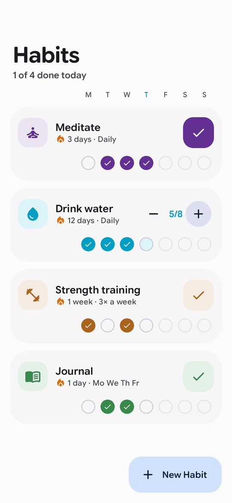<br><sub>Habits</sub></td>
  </tr>
  <tr>
    <td align="center">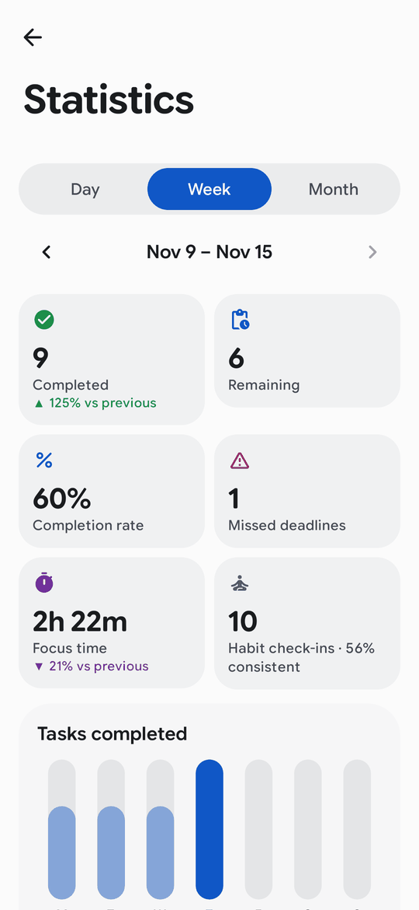<br><sub>Statistics</sub></td>
    <td align="center">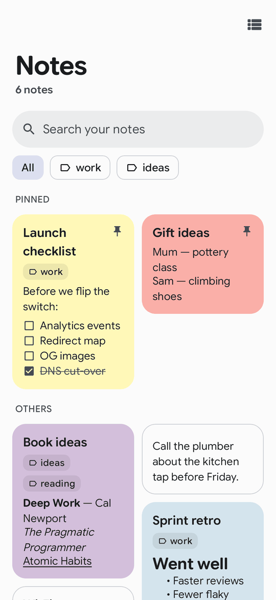<br><sub>Notes</sub></td>
    <td align="center">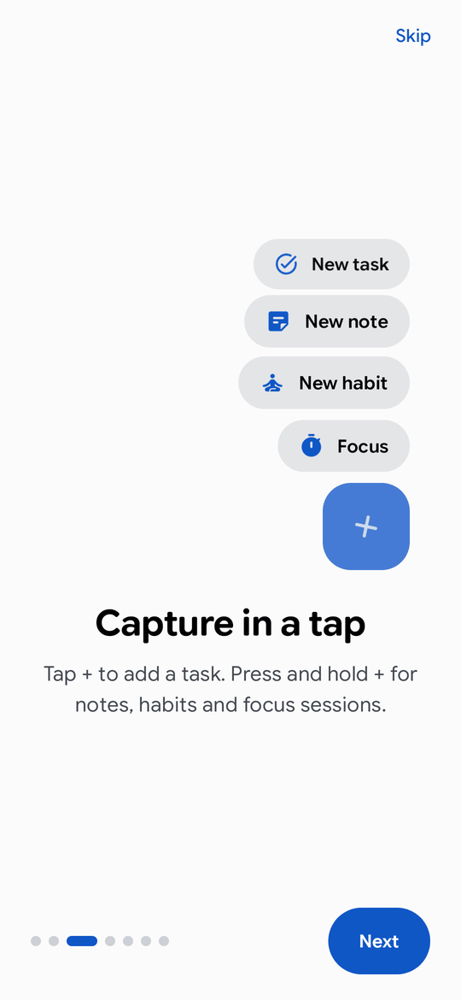<br><sub>Onboarding</sub></td>
    <td align="center">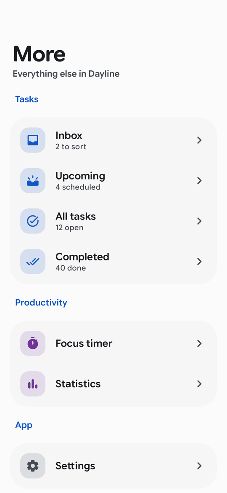<br><sub>More</sub></td>
  </tr>
</table>

**Dark mode**

<table>
  <tr>
    <td align="center">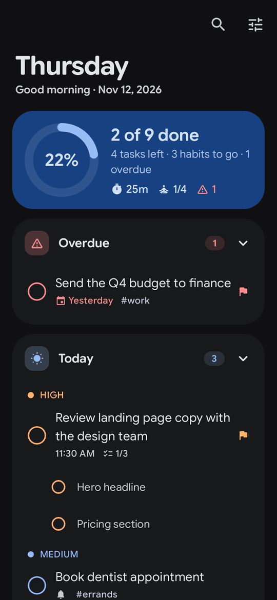<br><sub>Today</sub></td>
    <td align="center">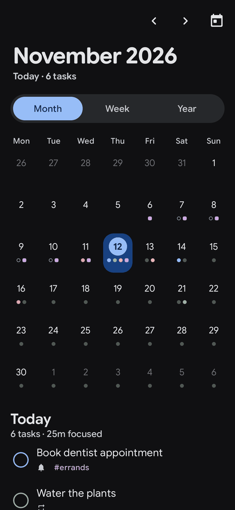<br><sub>Calendar</sub></td>
    <td align="center">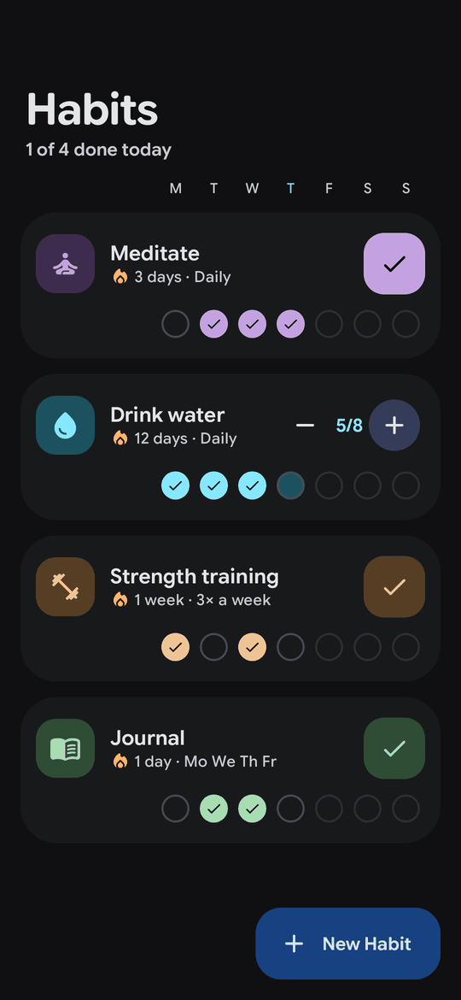<br><sub>Habits</sub></td>
    <td align="center">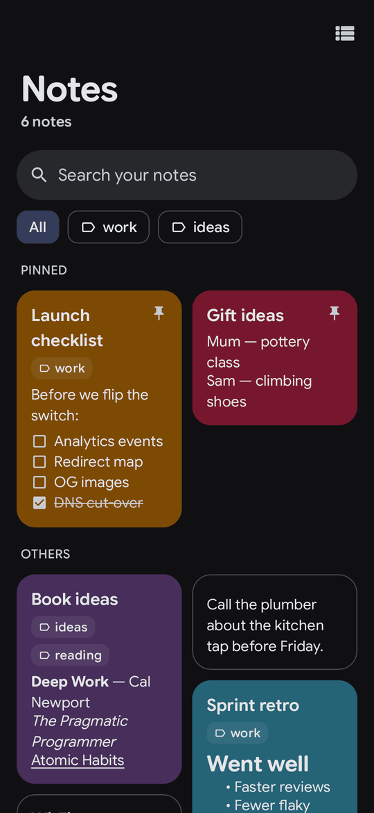<br><sub>Notes</sub></td>
  </tr>
</table>

## Tech stack

| | |
|---|---|
| Language & UI | Kotlin 2.3, Jetpack Compose, Material 3 Expressive |
| Architecture | MVVM with clean layers: pure-Kotlin domain rules, Room repositories as the single source of truth, `Flow`-driven screens |
| Data | Room, DataStore, JSON backup |
| Background work | WorkManager, AlarmManager (exact reminders), a background-safe focus timer |
| Widgets | Jetpack Glance |
| Sync | Google Identity authorization and the Drive REST API (`drive.appdata` scope only) |
| DI & tests | Hilt; JUnit, Robolectric, Turbine and Roborazzi screenshot tests across 9 phone set-ups |

```
app/src/main/java/com/dayline/app/
├── core/          models, domain rules (recurrence, streaks, stats, quick-add parser), Room, repositories, backup
├── notifications/ reminders, channels, alarm scheduling
├── focus/         focus timer controller
├── sync/          Google Drive sync
├── widget/        home-screen widgets
└── ui/            Compose screens, ViewModels, theme and components
```

## Getting started

**Requirements:** Android Studio 2025.2+ (or JDK 17 and Android SDK 36). Gradle downloads itself through the wrapper.

```bash
./gradlew :app:assembleDebug        # build the APK
./gradlew :app:installDebug         # install on a connected phone
./gradlew :app:testDebugUnitTest    # run all unit, flow and screenshot tests
```

In Android Studio: **File → Open**, choose this folder, wait for Gradle sync, then press **Run ▶**.

### Google sync (developer setup)
Sync needs a one-time Google Cloud setup: enable the **Google Drive API**, configure the OAuth consent screen with the `drive.appdata` scope, and add an **Android OAuth client** for `com.dayline.app` with your signing key's SHA-1. Every build writes that SHA-1 to `outputs/google-sync-setup.txt`. Users then connect with one tap in **Settings → Google sync**.

## License

The bundled Google Sans Flex font is licensed under the [SIL Open Font License](FONT_LICENSE_OFL.txt).

---

<p align="center">Made by <a href="https://github.com/VishalChavan7">Vishal Chavan</a> · <a href="https://vishalchavan7.github.io">vishalchavan7.github.io</a></p>
