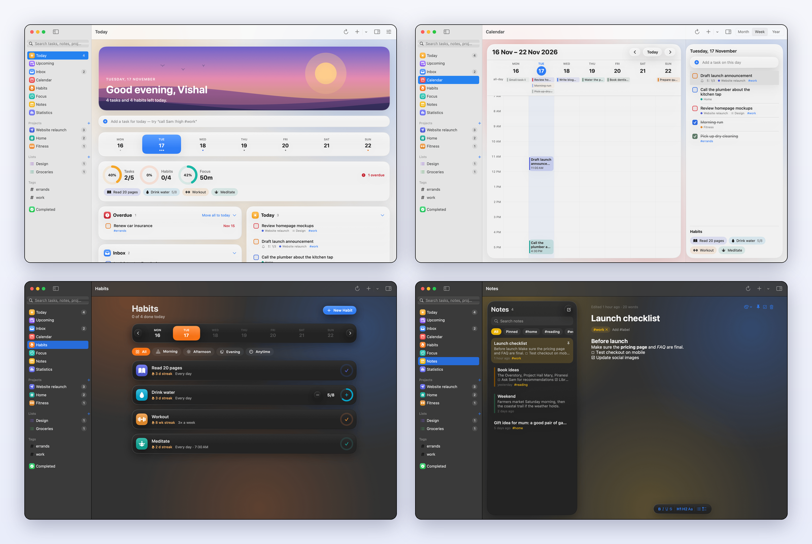
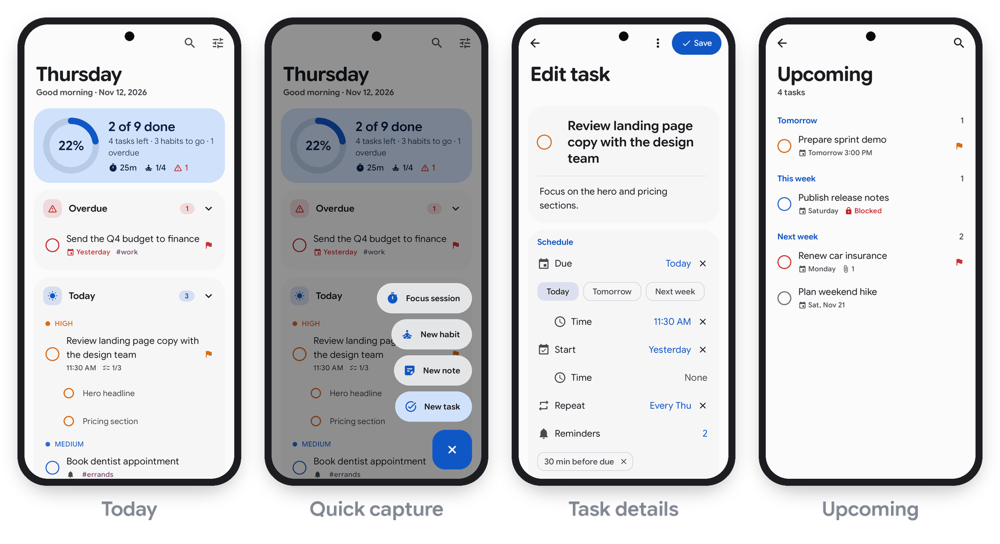

  

<h1 align="center">Dayline</h1>

  <b>Your whole day, in one calm place.</b> 
  Tasks, calendar, habits, focus sessions, notes and a journal on your Android phone and your Mac, kept in step through your own Google Drive.

  
  
  
  
  
  

---

## Demo

https://github.com/user-attachments/assets/f7b61f04-65f1-4bd7-b25c-8e7d26689c76

## Download

| | Get it | Needs |
|---|---|---|
| **Android** | [**Dayline for Android**](https://github.com/VishalChavan7/Dayline/releases/latest): download the `.apk` and open it on your phone | Android 8.0 or newer |
| **Mac** | [**Dayline for Mac**](https://github.com/VishalChavan7/Dayline/releases/tag/mac-v1.3.6): download the `.zip`, open it and drag **Dayline** into Applications | macOS 14 Sonoma or newer, Apple silicon (M1 or later) |

Both apps update themselves after you install them.

First time opening the apps

- **Android:** allow installing from your browser or file manager when Android asks. If Play Protect says it hasn't seen the app before, tap **Scan app** and then **Install**.
- **Mac:** Dayline isn't notarized by Apple yet, so the first time macOS says it can't verify the app. Open **System Settings → Privacy & Security**, scroll down and click **Open Anyway**. You only need to do this once.

## Why Dayline

Most people juggle a to-do app, a calendar, a habit tracker, a timer, a notes app and a journal. Dayline puts them all in one place, on your phone and your computer, so planning the day, doing the work and building routines happen together.

- **Students:** track assignments with due dates, plan the exam week on the calendar, and study in focus sessions.
- **Professionals:** capture tasks in a tap, set priorities and dependencies, and keep meeting notes with checklists next to them.
- **Habit builders:** check in daily, count reps or glasses of water, and watch your streaks grow.
- **Anyone who wants calm:** one clear Today view instead of five apps, and no account, ads or tracking.

## Features

### ☀️ Today
- A daily dashboard with a progress ring for tasks **and** habits, focus time and overdue count.
- Overdue, Today, Inbox and Upcoming deadlines sections, grouped by priority, plus a weekly summary and a daily quote.
- Choose which sections you see and in what order.

### ✅ Tasks
- **Quick capture** with natural typing: `tomorrow`, `friday`, `!high` and `#tag` are understood as you write.
- Due and start dates, times, repeats (daily, weekly, monthly, custom), multiple reminders, subtasks, links and attachments.
- **Dependencies:** a task waiting on another can't be completed or deleted until its blocker is done.
- Tags, plus Inbox, Upcoming (Tomorrow / This week / Next week), All tasks and Completed views.

### 📅 Calendar
- **Month, week and year** views, with repeating tasks shown ahead of time.
- Drag a task to another day to reschedule it.

### 🔥 Habits
- Daily, x-times-a-week or specific-day habits, plus counters (for example 5/8 glasses of water).
- Streaks that forgive unscheduled days, and a week-at-a-glance row of check-ins.

### ⏱️ Focus
- A Pomodoro-style focus timer with short and long breaks, linked to the task you're working on.
- A daily focus goal and a record of every session.

### 📊 Statistics
- Day, week and month views: completed vs. remaining, completion rate, missed deadlines, focus time and habit consistency, with trends against the previous period.
- A heatmap of everything you've completed over the last few months.

### 📝 Notes
- Rich text: bold, italic, underline, strikethrough, headings 1–6, text colours, highlighter, inline code, links and lists.
- Blocks: quotes, callouts (note, tip, important, warning, caution), code blocks, tables and line separators.
- Checklists, nested `#tags` (`#work/meetings`) with their own icons, colour-coded notes, pinning and search.
- Organise like Bear: Today, Pinned, Locked, Archive and Trash (restore anything until you empty it).
- `[[Wiki links]]` between notes with backlinks, a table of contents, word count and reading time, find and replace, and spell check.
- Lock a note behind your fingerprint, face, Touch ID or password.
- Export as Markdown, HTML, PDF or text, import Markdown and text files, and print.

### 📔 Journal
- A quiet place for a few lines a day, kept apart from your notes.
- A fresh writing prompt every day (shuffle for another), entries grouped by month, and bookmarks for the days you want to keep.
- Your writing streak, entries this year and words written at a glance.

### 🔔 Reminders and updates
- Reminders for tasks, habits and the focus timer, with **Complete** and **Snooze** right from the notification.
- Both apps check this page for new versions and offer a one-click update.

## On your phone

- **Home-screen widgets:** Today's tasks, Daily progress, Next up, Habit streaks, Streak flower, Focus timer and Quick add. They fit any home-screen grid, and each can have its own artistic background.
- **Material 3 Expressive design:** dynamic colour (Material You), monochrome and gradient themes, springy motion and haptics.
- **Gestures:** swipe right to complete and left to delete, with undo; press and hold **+** to add a note, habit or focus session.
- **Notes extras:** add images, drawings and voice notes.

## On your Mac

- **Looks like your phone:** the same colours, cards, round checkboxes and sections as Dayline on Android, on calm frosted Mac surfaces.
- **Today dashboard:** your progress ring, overdue and today's tasks grouped by priority, inbox, deadlines, focus and the week, in the order you choose.
- **Tasks and calendar:** month, week (laid out by the hour) and year views; drag tasks to a new day and time.
- **Habits:** tick today with one click, see your streak and this week at a glance, and open a habit for its history.
- **Notes and journal:** your colour-coded note cards beside a distraction-free editor, with labels, checklists and formatting, and a journal with daily prompts.
- **Widgets:** Today's tasks, Habits, Daily progress, Next up, Focus timer and Quick add for your desktop and Notification Centre. Tick tasks and habits or start the timer right from the widget, and pick each widget's background art in **Settings → Widgets**, just like on the phone.
- **Every phone theme:** the same accent colours, monochrome, gradient and dynamic themes as on Android.
- **Menu bar:** today's tasks and habits, quick add and the focus timer, without opening the app.
- **Notes like Bear:** tags, notes and editor in three panes (⌃1–⌃3); swipe left with two fingers (or ‹‹, ⌃⌘←) to fold away the sidebar, then the tags, then the list, and swipe right (››, ⌃⌘→) to bring them back, in Journal too. ⌥⌘1–⌥⌘6 for Notes, Today, Locked, Pinned, Archive and Trash, adjustable page margins in Settings → Notes, ⌘O Quick Open, a Format menu with shortcuts for every style, and statistics, contents and backlinks beside the note.
- **Keyboard first:** ⌘N new task, ⌥⌘N new note, ⇧⌘J new journal entry, ⇧⌘H new habit, ⌘R refresh, ⌘1–⌘9 to jump between sections, ⇧⌘F to start or pause the focus timer.

## Use it on your phone and Mac together

1. On your phone, open **Settings → Google sync** and connect your Google account.
2. On your Mac, connect the **same Google account** when Dayline asks (or later in **Settings → Sync**).

Your tasks, habits, notes, journal, focus history and settings then stay in step. Changes reach the other device within seconds while both apps are open. To check right away, pull down on your phone or click **Refresh** on the Mac. Edits made on both devices are merged item by item, so nothing is lost.

## Screenshots

**Plan your day**

**Calendar and habits**

**Insights and notes**

**Dark mode**

## Privacy

- Works fully offline. Everything is stored on your own devices.
- Google sync is optional. It keeps one private file in your own Google Drive's hidden app folder, which Dayline can't use to see any of your other files. Switch accounts or disconnect any time.
- No ads, no analytics, no tracking, and no Dayline server, so your data never goes to the developer.
- Export and restore a full backup any time; backups move freely between the phone and the Mac.
- Read the [privacy policy](https://vishalchavan7.github.io/privacy.html).

## Feedback and contributing

Found a bug or have an idea? [Open an issue](https://github.com/VishalChavan7/Dayline/issues/new/choose). Contributions of any kind are welcome, whether that's a bug report, a design tweak, a translation or code. See **[CONTRIBUTING.md](CONTRIBUTING.md)** to get started.

## License

Dayline is released under the **[MIT License](LICENSE)**. The bundled Google Sans Flex font is licensed separately under the [SIL Open Font License](FONT_LICENSE_OFL.txt).

---

Made by <a href="https://github.com/VishalChavan7">Vishal Chavan</a> · <a href="https://vishalchavan7.github.io">vishalchavan7.github.io</a>

